<p align="center"></p>

The website for [Coordinator](https://github.com/Kodexa-software/Coordinator), built with Astro and Starlight and
live at **[coordinator.kodexa.workers.dev](https://coordinator.kodexa.workers.dev)**.

## Develop

```sh
npm install
npm run dev      # sync Coordinator, then start the dev server
npm run build    # sync Coordinator, then build into dist/
```

Needs Node 22.22 or newer.

## Where things are

| Path | What |
|---|---|
| `src/pages/` | The landing page and other custom pages |
| `src/content/docs/docs/` | The documentation (Starlight) |
| `public/brand/` | Logo, mark, banner, favicon and fonts |
| `public/video/` | The showcase videos, made in Kodexa Video Studio |
| `DESIGN.md` | The brand and design system |
| `scripts/` | The Coordinator sync |
| `wrangler.jsonc` | Serves `dist/` as static assets on Cloudflare |

## Coordinator sync

Every `dev` and `build` first runs `scripts/sync-coordinator.mjs`, which reads Coordinator's version and
changelog so the site never drifts from the repo. By default it shallow-clones the Coordinator repo into
`.cache/coordinator`. To use a local clone instead:

```sh
COORDINATOR_DIR=~/.coordinator/app npm run dev
```

## Deploys

`.github/workflows/deploy.yml` builds the site and runs `wrangler deploy`:

- on every push to `main`, which includes every merged pull request;
- on demand, from the Actions tab (**Deploy**, then **Run workflow**);
- on every commit to Coordinator's `main`, through Coordinator's `.github/workflows/website.yml`. That needs the
  `WEBSITE_DEPLOY_TOKEN` secret in the Coordinator repo: a fine-grained token with **Actions: read and write** on
  Coordinator-Website. Without it, the hourly check catches up;
- hourly, but only when Coordinator's `HEAD` differs from the `sha` in the live `coordinator.json`. If that file
  can't be read, it builds anyway.

Two deploys never run at once. GitHub pauses scheduled workflows after 60 days without repo activity; if the
hourly check stops, open the Actions tab, pick **Deploy** and choose **Enable workflow**.

### Secrets

Add these under **Settings, Secrets and variables, Actions**:

| Secret | Value |
|---|---|
| `CLOUDFLARE_API_TOKEN` | An API token with **Workers Scripts: Edit** on the Kodexa account |
| `CLOUDFLARE_ACCOUNT_ID` | The Kodexa Cloudflare account ID |

Without both secrets the workflow still builds, but skips the deploy and leaves a warning naming what is missing.

Never commit either one.

### Manual fallback

```sh
npm run build && CLOUDFLARE_ACCOUNT_ID=<account> npx wrangler@4 deploy
```

## License

A [Kodexa](https://github.com/Kodexa-software) project, released under the MIT license.
